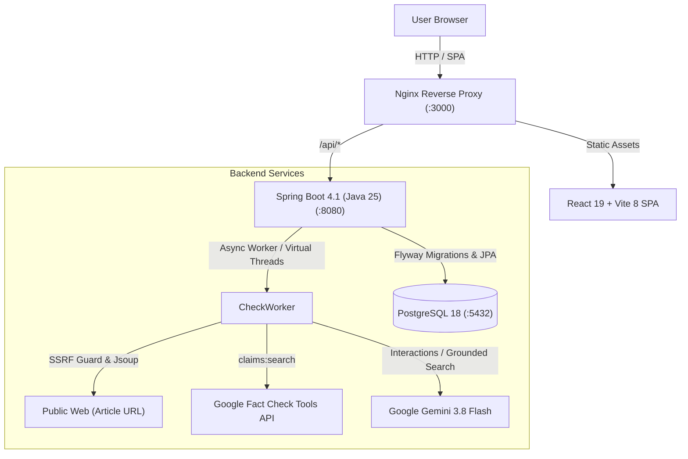

# VeryFact

> **AI-Powered Public Fact-Checking Platform**  
> Verify viral claims, suspicious news links, and social media screenshots against Google Fact Check Tools and Google Gemini (`gemini-3.8-flash`) with Google Search grounding — instantly producing shareable, citation-backed verdict reports.

---

## Highlights

- **Multimodal Submissions:** Fact-check raw article text, public article URLs (with SSRF protection), or uploaded screenshots/images (PNG, JPEG, WebP).
- **Double-Layer Verification:**
  1. Searches the official **Google Fact Check Tools API** for verified claims from accredited journalistic fact-checkers (PolitiFact, AFP, FactCheck.org, etc.).
  2. Synthesizes evidence using **Gemini 3.8 Flash** grounded with **Google Search** to identify claims, evaluate truthfulness, detect red flags, and cite primary sources.
- **Explainable Verdicts:** Every check produces an overall verdict badge (`True`, `Mostly true`, `Mixed`, `Mostly false`, `False`, `Unverifiable`), a confidence percentage, manipulative red flags, and claim-by-claim breakdowns with primary source links.
- **Shareable Reports:** Permanent, public result URLs (`/r/{slug}`) that anyone can inspect or share without logging in.
- **Privacy & Security First:**
  - Zero authentication required.
  - No user content or client IP addresses persisted to disk or logged.
  - In-memory sliding-window IP rate limiting uses salted SHA-256 hashes generated from an ephemeral per-boot salt.
  - Multi-hop SSRF protection blocks private IP ranges, loopbacks, link-local addresses, and AWS/GCP cloud metadata endpoints.
  - Content-hash deduplication (SHA-256) returns cached results for identical submissions within 7 days, eliminating redundant AI calls.

---

## Architecture



---

## Tech Stack

| Layer | Technologies |
|---|---|
| **Backend** | Spring Boot 4.1.1, Java 25 (Virtual Threads), Maven Wrapper, PostgreSQL 18, Flyway, Spring Data JPA, Hibernate 7, Official Google Gen AI Java SDK (`com.google.genai:google-genai`), Jsoup, Spotless (`palantirJavaFormat`), SpringDoc OpenAPI |
| **Frontend** | React 19, Vite 8, TypeScript 6, Tailwind CSS v4, Base UI (shadcn/ui), TanStack Query, Axios, Vitest, Oxlint, Prettier |
| **DevOps / Quality** | Docker & Docker Compose, Multi-stage Dockerfiles, Nginx 1.29, Husky pre-commit hooks, lint-staged, GitHub Actions CI |

---

## AI-Assisted Engineering Workflow

VeryFact was architected and built using an agentic pair-programming workflow:
- **Agent Instructions & Skill System:** Hierarchical [`AGENTS.md`](./AGENTS.md) files in root, `backend/`, and `frontend/` establish coding conventions, strict definition of done, and privacy policies. Reusable skills in [`.agents/skills/`](./.agents/skills/) automate tasks like API contract synchronization ([`sync-api-contract`](./.agents/skills/sync-api-contract/SKILL.md)) and adding endpoints ([`add-api-endpoint`](./.agents/skills/add-api-endpoint/SKILL.md)).
- **Contract-Driven API Sync:** OpenAPI specs in `contracts/openapi.json` automatically generate type-safe TypeScript interfaces (`frontend/src/api/schema.d.ts`), preventing frontend-backend API drift.
- **Architecture Decision Records:** Core technical choices (e.g. Java 25 Virtual Threads, official Google Gen AI Java SDK, privacy-first IP hashing) are documented in [`docs/adr/`](./docs/adr/).
- **Automated Quality Gates:** Pre-commit hooks via Husky, Spotless, Oxlint, and Prettier enforce formatting and linting rules on every commit.

---

## Quickstart

### Prerequisites
- **Git**
- **Docker Desktop** (or Docker engine + Compose)
- **Java 25 JDK** & **Node.js 24+** (for local development)
- **Google Gemini API Key** (from [Google AI Studio](https://aistudio.google.com/app/apikey))

### 1. Clone & Configure Environment

```bash
git clone https://github.com/kingsmark16/VeryFact.git
cd VeryFact
cp .env.example .env
```

Edit `.env` and add your Gemini API key:
```ini
GEMINI_API_KEY=your_gemini_api_key_here
```

*(Optional: `GOOGLE_FACTCHECK_API_KEY` can also be provided; if omitted, `GEMINI_API_KEY` is used as fallback).*

---

### 2. Run with Docker Compose (Full Stack)

To build and run all 3 services (**PostgreSQL 18**, **Spring Boot 4.1**, and **React 19 + Nginx**) with a single command:

```bash
docker compose --profile fullstack up --build
```

- **Frontend:** [http://localhost:3000](http://localhost:3000)
- **Backend API:** [http://localhost:8080/api/checks](http://localhost:8080/api/checks)
- **Swagger UI:** [http://localhost:8080/swagger-ui.html](http://localhost:8080/swagger-ui.html)

---

### 3. Run for Local Development

#### Start Database
```bash
docker compose up -d
```

#### Run Backend
```bash
cd backend
.\mvnw.cmd spring-boot:run
```

#### Run Frontend
```bash
cd frontend
npm install
npm run dev
```

Open [http://localhost:5173](http://localhost:5173) in your browser.

---

## Verification & Testing

Run full CI verification suites locally:

```bash
# Backend (unit tests, web slice tests, spotless check)
cd backend
.\mvnw.cmd verify

# Frontend (oxlint, prettier check, typescript check, vitest, production build)
cd frontend
npm run check
```

---

## API Reference

### Submit a Check
```http
POST /api/checks
```

**JSON (Text Submission):**
```json
{
  "text": "Breaking: NASA confirms asteroid 2026-X will pass between Earth and Moon."
}
```

**Multipart Form (URL and/or Images):**
- `url`: `https://example.com/news-story`
- `text`: (optional context)
- `images`: (1-4 image files, JPEG/PNG/WebP, max 5 MB each)

**Response (`202 Accepted`):**
```json
{
  "slug": "k7X9p2Lm1A",
  "status": "PROCESSING",
  "stage": "SEARCHING_FACT_CHECKS",
  "cached": false
}
```

### Get Check Results
```http
GET /api/checks/{slug}
```

**Response (`200 OK`):**
```json
{
  "slug": "k7X9p2Lm1A",
  "inputType": "URL",
  "status": "COMPLETED",
  "stage": "COMPLETED",
  "overallVerdict": "MOSTLY_TRUE",
  "confidence": 0.88,
  "summary": "Asteroid 2026-X did pass safely between the Earth and Moon on...",
  "claims": [
    {
      "claim": "NASA confirmed asteroid 2026-X trajectory.",
      "verdict": "TRUE",
      "confidence": 0.95,
      "explanation": "NASA JPL Asteroid Watch published orbital tracking data confirming the flyby.",
      "sources": [
        {
          "title": "NASA Asteroid Watch",
          "url": "https://www.jpl.nasa.gov/asteroid-watch",
          "domain": "jpl.nasa.gov"
        }
      ]
    }
  ],
  "redFlags": []
}
```

---

## License

This project is licensed under the [MIT License](LICENSE).

