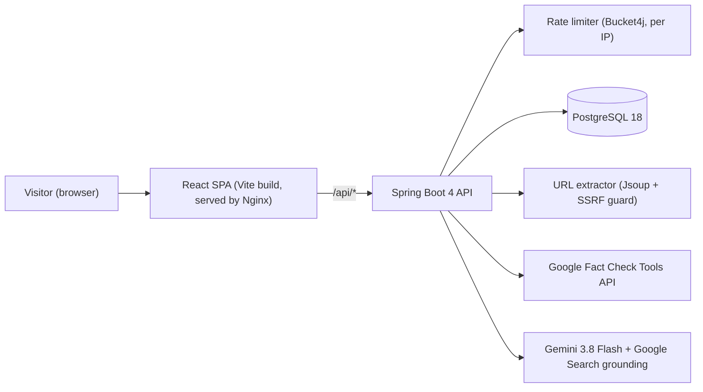
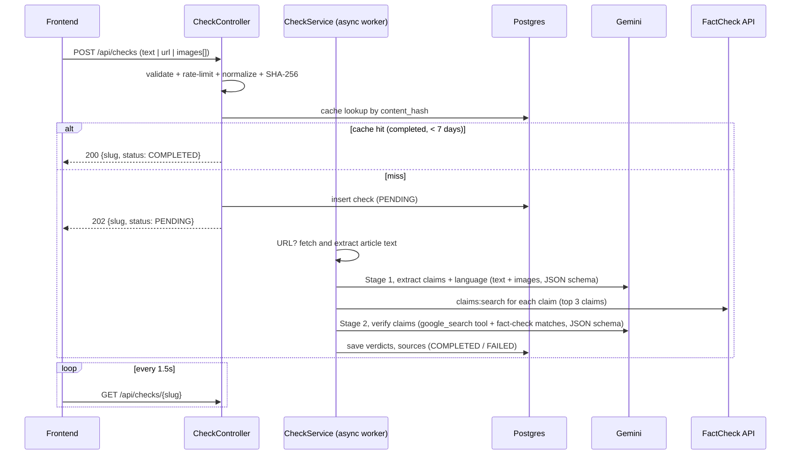

# VeryFact — Architecture

## System Overview

## Check Pipeline

## REST API

| Method | Path | Purpose |
|---|---|---|
| `POST` | `/api/checks` | `multipart/form-data`: `text?`, `url?`, `images[]?` (max 4 × 5 MB, jpeg/png/webp; text ≤ 20,000 chars). Returns `202` (new) or `200` (cache hit) with `{slug, status}` |
| `GET` | `/api/checks/{slug}` | Status + full result (`PENDING / PROCESSING / COMPLETED / FAILED`, current `stage` for the progress UI) |
| `GET` | `/actuator/health` | Health check for Docker |
| `GET` | `/v3/api-docs` | OpenAPI spec (source for TypeScript client generation) |

