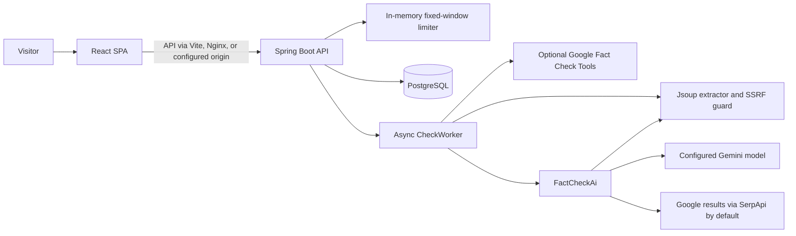

# VeryFact — Architecture

Last synchronized with the repository: 2026-11-02.

## System

Backend: Spring Boot 4.1.1 / Java 25, virtual threads, JPA and Flyway. Frontend: React 19 / Vite 8 / TypeScript 6, React Router, TanStack Query, Axios, Tailwind v4 and shadcn/Base UI. No login service, message broker, or durable job queue is implemented.

## Pipeline

1. `RateLimitFilter` applies to `POST /api/checks`: default 10 requests per hour, a fixed window beginning with the first request for a salted remote-address hash. State lives in a process-local concurrent map. Exceeding the limit returns `429 application/problem+json` and `Retry-After` seconds. The filter uses the servlet remote address, not manually parsed forwarded headers.
2. `CheckController` accepts JSON text or multipart text/URL/images. `CheckService` validates limits and public URLs; `ImageValidator` checks count/size and derives supported MIME types from byte signatures. Normalized SHA-256 keys identify content; multipart keys include URL and ordered image-byte hashes.
3. A matching `COMPLETED` report created within the past hour is reused only if its model version ends in `-search-v1`. This does not deduplicate in-flight work or expire stored reports. Otherwise a new `PENDING / QUEUED` row is saved and work is dispatched asynchronously.
4. `CheckWorker` sets `PROCESSING / EXTRACTING_CLAIMS`. For URLs it extracts article text and combines it with context. Failed extraction continues with the submitted URL/context and an explicit unavailable-page note; it does not invent article text.
5. At `SEARCHING_FACT_CHECKS`, optional Google Fact Check Tools lookup uses combined text. Image-only submissions without text skip this lookup. Missing credentials or lookup failure yield no matches; connect/read timeouts are two/three seconds.
6. At `VERIFYING_CLAIMS`, `FactCheckAi` runs the configured route below. Success saves language, verdict, confidence, summary, claims/notes JSON, model provenance, completion timestamp, and `COMPLETED` status/stage. Failure saves `FAILED`, completion time, and a public error message.
7. The frontend polls every 1.5 seconds until `COMPLETED` or `FAILED`. Despite its name, `ProgressSteps` renders an orbital animation and one actual-stage message. See the [product specification](PRODUCT_SPEC.md) for report interactions.

## Search providers

### Default: `GOOGLE_SEARCH_PROVIDER=serpapi`

`GoogleSearchFactCheckAi` is the primary implementation. It requires a SerpApi key and a Gemini 3 model; the application default is `gemini-3.5-flash-lite`.

- A tool-free constrained-JSON Gemini request plans one query, or two for unrelated central claims, at most 250 characters each. Images are included when submitted.
- `SerpApiSearchClient` requests `engine=google` and `no_cache=true`. It accepts successful responses and up to three usable organic results per query, with two-second connect/ten-second read timeouts. URLs are deduplicated across queries.
- The backend attempts to fetch the first three unique result pages through `ArticleExtractor`, retaining at most 5,000 characters per page. Failed fetches retain the snippet and empty page text; prompts distinguish these cases.
- A second tool-free constrained-JSON Gemini request evaluates one to four central claims from supplied evidence and optional fact-check leads.
- Local validation rejects incomplete/invalid reports and citations whose exact URLs are absent from retrieved results. Titles/publishers come from search metadata. Every claim except `UNVERIFIABLE` requires a Google source. These checks constrain provenance, not factual correctness.
- Model provenance is `<configured-model>-serpapi-search-v1`.

### Optional: `GOOGLE_SEARCH_PROVIDER=gemini`

`GeminiFactCheckAi` uses native Google Search. Gemini 3 uses Interactions with LOW thinking and requires completed output plus a non-error, nonempty search-result step. Configured Gemini 2.5 models use `generateContent`, `thinkingBudget=0`, prompted JSON, and local validation; completion, search queries, and HTTP(S) web-source grounding metadata are required. Native provenance is `<configured-model>-search-v1`.

Native search requires account/model access and does not enforce the default route's exact-result citation allowlist. Neither route silently switches models/providers, retries without search, or generates demo verdicts. Unknown provider names fail configuration validation.

## Deadlines, failures, and recovery

The Gemini client is reused and closed on shutdown, with SDK retry attempts set to one. `GEMINI_REQUEST_TIMEOUT` defaults to 60 seconds and must be between 1 ms and 120 seconds. The deadline covers the default route's planning/search/page retrieval/report generation, or the native model request. Submitted-URL extraction and optional Fact Check lookup happen before it. Timeout cancels the request task and fails the check; this is not an end-to-end latency guarantee.

Every 30 seconds `CheckRecovery` fails pending/processing rows created more than five minutes earlier, including work abandoned by restart. It does not resume work or delete reports.

Worker failures become saved report data: `GET` of an existing failed check returns `200`. Public messages distinguish recognized timeout, model access, search availability, quota, and configuration issues. Logs use check IDs, exception classes, and allowlisted reason codes rather than arbitrary provider messages. Controller validation and missing slugs use RFC 9457 `ProblemDetail` errors.

## HTTP API

| Method | Path                 | Contract                                                                                                                                                                                                                                                                                                    |
| ------ | -------------------- | ----------------------------------------------------------------------------------------------------------------------------------------------------------------------------------------------------------------------------------------------------------------------------------------------------------- |
| `POST` | `/api/checks`        | JSON `{text}` (20–20,000 characters), or multipart optional `text`, `url`, repeated `images`; at least one input required. Text-only multipart requires 20 characters; shorter context is permitted with URLs/images. Maximum four JPEG/PNG/WebP images, 5 MiB each; configured total multipart size 22 MB. |
|        |                      | Response `{slug,status,stage,cached}`: `202` new work, `200` cached. New rows start `PENDING / QUEUED`; poll for current progress.                                                                                                                                                                          |
| `GET`  | `/api/checks/{slug}` | `CheckResultDto`: input type/URL/excerpt, language, status/stage, verdict/confidence/summary, claims, red flags, error, model version, creation/completion times. Unknown slug: `404`.                                                                                                                      |
| `GET`  | `/api/checks/recent` | Up to six completed rows with non-null verdict, descending creation time. Fields: slug, input type/excerpt, verdict, confidence, summary, creation time. No provenance filter, pagination, or user scope.                                                                                                   |
| `GET`  | `/actuator/health`   | Spring health endpoint; Compose defines a healthcheck only for the database.                                                                                                                                                                                                                                |
| `GET`  | `/v3/api-docs`       | Generated OpenAPI; Swagger UI at `/swagger-ui.html`.                                                                                                                                                                                                                                                        |

Statuses: `PENDING`, `PROCESSING`, `COMPLETED`, `FAILED`. Stages: `QUEUED`, `EXTRACTING_CLAIMS`, `SEARCHING_FACT_CHECKS`, `VERIFYING_CLAIMS`, `COMPLETED`, `FAILED`. Input types: `TEXT`, `URL`, `IMAGE`, `MIXED`.

`ClaimDto` contains claim, verdict, confidence, explanation, `sources[]`, and `factChecks[]`. `SourceDto` is `{title,url,publisher}`. `FactCheckMatchDto` is `{claimText,claimant,publisher,title,url,textualRating}`. The parser attaches optional lookup matches to each claim; this is not a separate semantic-match guarantee. Claim and overall DTOs share the seven-value enum in [PRODUCT_SPEC.md](PRODUCT_SPEC.md), while the generation schema limits per-claim verdicts to six values and reserves `SATIRE_OR_OPINION` for the overall report.

Spring-generated OpenAPI is authoritative. `BackendApplicationTests` exports `contracts/openapi.json`; `npm run gen:api` generates `frontend/src/api/schema.d.ts`. Request functions/hooks are handwritten Axios wrappers typed from generated schemas. Separate CI jobs do not currently compare regenerated artifacts for drift.

## Persistence, privacy, and extraction

Flyway V1 creates `fact_check`: UUID, public slug, content hash, input type, source URL, excerpt, language, status/stage, verdict, confidence, summary, JSONB claims/notes, public error, model version, and timestamps. JPA validates rather than creates the schema.

The database stores the first 500 text characters plus an ellipsis when truncated, or a URL/image-count description. Full raw text and image bytes have no dedicated persistent fields; reports can repeat submitted material. No retention/deletion job exists. Report/recent endpoints are public. Application code does not log submissions, keys, arbitrary provider errors, or client IPs; proxy/platform logs are configured separately.

`ArticleExtractor` uses Jsoup with a ten-second request timeout, 2 MiB body limit, up to three redirects, and at most 18,000 extracted characters. The SSRF guard validates HTTP(S) public addresses and revalidates redirect destinations. Prompts delimit untrusted submissions/evidence and instruct the model to ignore embedded instructions. Relevant content/queries are sent to external providers as described in [README.md](../README.md).

## Code and runtime map

- Backend: `check/` (controller, service, worker, recovery, domain, DTOs), `ai/`, `search/`, `factcheck/`, `extractor/`, `config/`, and `common/`.
- Frontend: `app/` (router/providers), `api/` (Axios/generated schemas), `features/check/` (API hooks, pages, evidence/loading components and report copy), `components/layout/`, `components/ui/`, and `lib/` (i18n/utilities).
- Local runtime: PostgreSQL 18 via Compose, Spring on 8080, Vite on 5173. Full-stack Compose uses Nginx on 3000 with `/api` proxied to `backend:8080`. See [deployment configuration and limitations](DEPLOYMENT.md).
